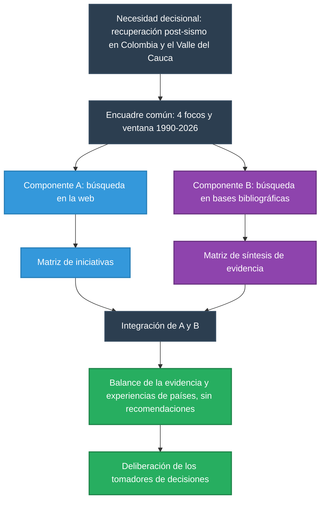
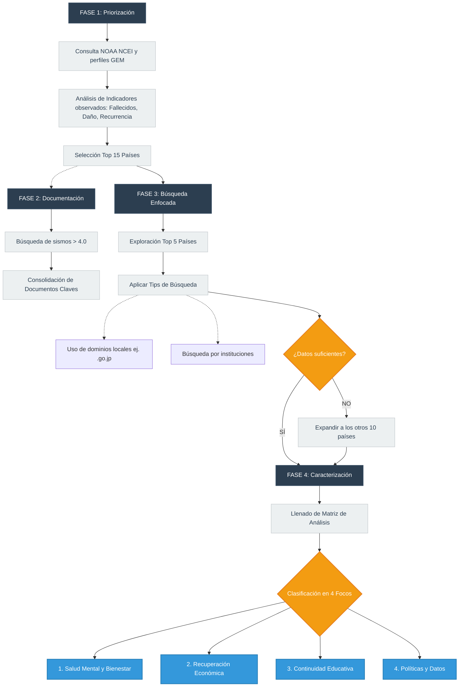
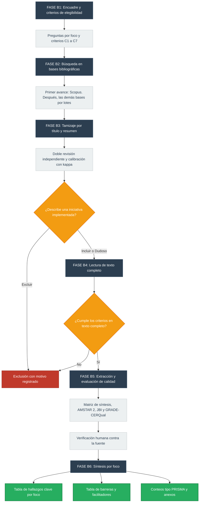

# Vigilancia estratégica pos-terremoto: propuesta metodológica

**Versión:** 2.1 (borrador en revisión) · **Fecha:** 16 de octubre de 2026
**Marco metodológico:** vigilancia estratégica (UNE 166006:2018) + síntesis de evidencia para la toma de decisiones

> **La vigilancia no emite recomendaciones.** Presenta el balance de la evidencia (beneficios, efectos negativos y costos) y las
> experiencias de otros países, para que la decisión se delibere con esa información.

## Contenido

1. [Propósito](#1-propósito)
2. [Marco metodológico](#2-marco-metodológico)
3. [Focos estratégicos](#3-focos-estratégicos)
4. [Definiciones operativas](#4-definiciones-operativas)
5. [Arquitectura general: dos componentes complementarios](#5-arquitectura-general-dos-componentes-complementarios)
6. [Componente A: iniciativas en la web](#6-componente-a-iniciativas-en-la-web)
7. [Componente B: evidencia científica](#7-componente-b-evidencia-científica)
8. [Integración de A y B y productos](#8-integración-de-a-y-b-y-productos)
9. [Uso de inteligencia artificial](#9-uso-de-inteligencia-artificial)
10. [Limitaciones](#10-limitaciones)
11. [Registro de cambios](#11-registro-de-cambios)

---

## 1. Propósito

El objetivo de esta vigilancia es informar a la Vicerrectoría de Investigación y a NODOS Icesi sobre las intervenciones, estrategias e
iniciativas implementadas después de terremotos. Este conocimiento servirá como insumo para diseñar o fortalecer programas de recuperación
en Colombia y políticas públicas de reconstrucción en el Valle del Cauca. Para ello, el estudio combina dos búsquedas complementarias —una
académica y otra en la web— orientadas a caracterizar las acciones de países con alta sismicidad y la evidencia de sus respuestas. El
producto final no emite recomendaciones, sino que expone el balance de la evidencia (beneficios, efectos negativos y costos) junto con las
experiencias internacionales, con el fin de que las decisiones se tomen con base en esta información.

## 2. Marco metodológico

| Marco | Descripción |
|---|---|
| **Vigilancia estratégica: norma UNE 166006:2018, «Gestión de la I+D+i: Sistema de vigilancia e inteligencia»** | Norma española publicada en 2018 por la Asociación Española de Normalización (UNE). Su objeto es facilitar la formalización y la estructuración del proceso de recolección y análisis de información sobre el entorno de una organización, para apoyar la toma de decisiones en todos sus niveles. Propone establecer un sistema permanente de vigilancia e inteligencia y se puede aplicar en cualquier organización, sin importar su tamaño, sector o ubicación geográfica |
| **Síntesis de evidencia para la toma de decisiones** (patrón de la Unidad de Evidencia y Deliberación, UNED, de la Universidad de Antioquia, basado en las herramientas SUPPORT, el McMaster Health Forum y la red EVIPNet de la OMS) | Enfoque que identifica, selecciona, evalúa y sintetiza de manera sistemática y transparente la mejor evidencia disponible sobre un problema, las opciones para abordarlo y las consideraciones de su implementación. Su producto alimenta la deliberación de quienes deciden: presenta beneficios, efectos negativos, costos e incertidumbre, sin emitir recomendaciones |

## 3. Focos estratégicos

1. Salud mental y bienestar humano y animal
2. Recuperación económica empresarial
3. Continuidad educativa y educación en gestión del riesgo
4. Políticas públicas y datos para futuras emergencias

## 4. Definiciones operativas

| Término | Definición |
|---|---|
| **Iniciativa** | Programa, estrategia, proyecto, política o acción **implementada por una entidad identificable** en respuesta a un evento sísmico o para prepararse ante uno |
| **Buena práctica** | Iniciativa que cumple al menos tres condiciones: (a) implementación documentada; (b) resultados reportados o evaluados; (c) información suficiente para valorar su transferibilidad |
| **Resultado reportado** | Resultado declarado por la entidad que implementa la iniciativa |
| **Resultado evaluado** | Resultado medido con un diseño de evaluación, idealmente independiente |
| **Estrategia exitosa** | Término reservado para iniciativas con **evidencia evaluada** de resultados positivos. En los demás casos se habla de «iniciativa con resultados reportados» |

## 5. Arquitectura general: dos componentes complementarios

La vigilancia integra **dos componentes de búsqueda de información**. Cada uno tiene fases metodológicas propias, pero son
complementarios: juntos abordan de manera holística la existencia de iniciativas y buenas prácticas implementadas a nivel global tras
eventos sísmicos.

| Aspecto | Componente A: iniciativas en la web | Componente B: evidencia científica |
|---|---|---|
| **Pregunta central** | ¿Qué han hecho los países con alto impacto sísmico y cómo lo organizaron? | ¿Qué intervenciones se han implementado, qué se sabe de sus efectos y qué facilitó o dificultó su implementación? |
| **Fuentes** | Portales gubernamentales y de organismos oficiales, informes institucionales y documentos de organismos internacionales | Bases de datos bibliográficas científicas |
| **Unidad de análisis** | La iniciativa | El estudio (o la revisión) que describe una iniciativa implementada |
| **Resultado** | Matriz de iniciativas | Matriz de síntesis (evidencia) |
| **Naturaleza de la evidencia** | Descriptiva: muestra qué existe y cómo se organiza | Efectos, calidad de la evidencia, barreras y facilitadores |
| **Cobertura geográfica** | Los 15 países priorizados en la Fase 1 | Todos los países; los 15 priorizados y Colombia tienen prioridad de procesamiento |
| **Ventana de tiempo** | 1990–2026 | 1990–2026 (año de publicación) |

---

## 6. Componente A: iniciativas en la web

**Objetivo:** identificar, seleccionar y caracterizar las intervenciones, estrategias e iniciativas implementadas después de terremotos en
los 15 países priorizados, mediante búsqueda en la web.

### 6.1 Hoja de ruta

### 6.2 Detalle operativo por fases

#### Fase 1: Perfilamiento y priorización de países
**Objetivo:** definir y justificar cuantitativamente una muestra (Top 15) de países a partir del **impacto sísmico observado** entre 1990
y 2026, para enfocar la búsqueda de iniciativas.

* **Fuente de selección:** [NOAA / NCEI, *Global Significant Earthquake Database*](https://www.ncei.noaa.gov/products/natural-hazards/tsunamis-earthquakes-volcanoes/earthquakes)
  (doi 10.7289/V5TD9V7K), consultada mediante la herramienta HazEL. Se trata de datos de eventos realmente ocurridos, no de proyecciones
  de riesgo.
* **Filtros aplicados:** año igual o posterior a 1990, magnitud igual o superior a 4.0, exclusión de eventos con bandera volcánica y de
  eventos sin impacto documentado. Base resultante: **1.507 eventos en 109 países**.
* **Extracción de variables clave:** de cada evento se extraen fallecidos, heridos, daño económico, viviendas destruidas y viviendas
  dañadas. Agregadas por país, estas variables producen tres ordenamientos independientes: **fallecidos acumulados, daño acumulado y
  número de eventos con impacto**.
* **Criterio de selección:** el impacto no es una sola variable, de modo que la muestra se define por **intersección**: los países que se
  ubican entre los veinte primeros en los tres rankings a la vez (8 países). Los 7 restantes se incorporan por **priorización declarada y
  vinculada a los focos** del estudio, hasta completar 15.
* **Fuente de contexto:** los [perfiles de riesgo sísmico de GEM](https://www.globalquakemodel.org/product/global-seismic-risk-map) aportan
  los indicadores sociales (población, PIB, índice de Gini), las clases constructivas, las prefecturas o divisiones con mayor nivel de
  pérdida y la **razón de pérdida anual promedio (AALR)** como indicador de vigencia del riesgo. Al ser resultado de un modelo
  probabilístico y no de eventos ocurridos, **no participan en la selección ni en el orden de los países**.
* **Eventos ancla:** de la base NOAA se extraen, por país, los terremotos de mayor impacto con año, magnitud, localidad, fallecidos y daño.
  Son el punto de partida de la Fase 3, porque la mayoría de las iniciativas nace como respuesta institucional a un evento concreto.
* **Países priorizados:** China, Turquía, Indonesia, Japón, Irán, Pakistán, India, Taiwán, Haití, Nepal, Afganistán, Chile, Italia,
  México y Ecuador. Colombia es el país de destino de la vigilancia.
* **Entregable (Ficha 1 - Contexto_país):** documento que consolida el Top 15 de países priorizados. La inclusión de cada país se justifica
  con su posición en los tres rankings observados y con el criterio de entrada declarado (intersección o priorización por foco),
  acompañada del AALR como nota de vigencia del riesgo.

#### Fase 2: Soporte documental (marco de referencia)
**Objetivo:** establecer la base teórica e histórica que respalde la investigación.
* **Metodología de rastreo:** búsquedas estructuradas y desestructuradas en español e inglés sobre eventos sísmicos con magnitudes
  superiores a 4.0.
* **Entregable (Ficha 2 - Documentos claves):** consolidado de literatura y reportes oficiales que servirán como soporte documental de la
  vigilancia.

#### Fase 3: Búsqueda enfocada de iniciativas
**Objetivo:** rastrear iniciativas gubernamentales e institucionales de acceso gratuito en la web.
* **Despliegue inicial:** la exploración arranca en los **primeros 5 países** del Top 15. Si no se halla información suficientemente
  documentada o accesible para caracterizar las prácticas, se procede con una reorientación estratégica hacia los **10 países restantes**
  de la muestra.
* **Tips de búsqueda:**
  * **Filtros por dominio local:** modificación de la ubicación en navegadores y uso restrictivo de dominios específicos por país (por
    ejemplo, `site:.go.jp` para rastrear ministerios en Japón).
  * **Búsqueda por hitos y entidades:** evitar términos genéricos que arrojan ruido (por ejemplo, *«buenas prácticas de salud mental en
    Japón»*). En su lugar, rastrear instituciones con nombre propio creadas tras desastres específicos (por ejemplo, *«qué se creó después
    de Kobe 1995»*).
  * **Geolocalización del desastre:** emplear los nombres exactos de las ciudades o prefecturas con mayores afectaciones (identificadas en
    la Fase 1) para hallar programas de recuperación locales.
* **Jerarquía de fuentes:**
  * **Principales:** portales gubernamentales y de organismos oficiales, informes institucionales y documentos de organismos
    internacionales.
  * **Complementarias:** redes sociales oficiales de las entidades.
  * **Canales de noticias locales:** solo sirven como **pista** para encontrar la fuente oficial. No se usan como evidencia de resultados.

#### Fase 4: Caracterización y extracción de datos
**Objetivo:** sistematizar las iniciativas implementadas dentro de la ventana 1990–2026, extraídas de las fuentes de la Fase 3.
* **Entregable (Ficha 3 - Matriz de iniciativas):** instrumento central del componente, donde se desglosa cada iniciativa con las
  siguientes unidades de análisis:

  | Variable | Qué registra |
  |---|---|
  | País | País donde se implementó la iniciativa |
  | Región/Ciudad | Territorio subnacional de implementación |
  | Evento sísmico/Año | Terremoto al que responde la iniciativa, o ante el cual se prepara |
  | Nombre de la iniciativa | Nombre propio del programa, estrategia, proyecto, política o acción |
  | Entidad responsable | Entidad identificable que la implementa |
  | Tipo de entidad | Naturaleza de la entidad (por ejemplo, gubernamental o institucional) |
  | Descripción | En qué consiste la iniciativa |
  | Población objetivo | A quién va dirigida |
  | Cobertura reportada | Alcance declarado por la entidad |
  | Resultado esperado | Lo que la iniciativa se propone lograr |
  | URLs de soporte | Enlaces a las fuentes que respaldan cada dato |

* **Clasificación por focos estratégicos:** cada iniciativa documentada se clasifica en los cuatro focos de la sección 3.
* **Regla de lectura:** la evidencia de este componente es **descriptiva**. Una iniciativa solo cuenta como evidencia de efecto si tiene una
  evaluación documentada. Un resultado esperado o autodeclarado no es un beneficio demostrado.
* **Verificación:** cada registro se verifica por una persona contra su URL de soporte (ver sección 9).

---

## 7. Componente B: evidencia científica

**Objetivo:** identificar, seleccionar, evaluar y sintetizar la evidencia científica disponible en bases de datos bibliográficas sobre
intervenciones, estrategias e iniciativas implementadas después de terremotos en los cuatro focos. La síntesis cubre sus efectos
(beneficios, efectos negativos y costos), las barreras y los facilitadores de su implementación.

### 7.1 Hoja de ruta

### 7.2 Detalle operativo por fases

#### Fase B1: Encuadre y criterios de elegibilidad
**Objetivo:** fijar, antes de buscar, qué entra y qué no, para decidir registro por registro con criterios explícitos.

Un registro se incluye si cumple **todos** los criterios:

| # | Criterio | Regla |
|---|---|---|
| C1 | Evento | Solo **terremotos** o preparación ante ellos. Entran los eventos compuestos desencadenados por un sismo (por ejemplo, sismo y tsunami de Tōhoku 2011). **No se admite evidencia indirecta de otros desastres en ningún foco** |
| C2 | Iniciativa | Describe una iniciativa concreta **implementada** por una entidad identificable (ver la regla del Tipo A) |
| C3 | Foco | Se ubica en al menos uno de los cuatro focos. Antes de excluir por desenlace se revisan los otros focos y, si encaja en otro, se reasigna el foco principal |
| C4 | Desenlace | Mide al menos un desenlace pertinente al foco. Es un criterio permisivo, porque la vigilancia mapea lo que existe |
| C5 | Periodo | Año de **publicación** entre 1990 y 2026 |
| C6 | Idioma | Español, inglés o portugués |
| C7 | Diseño | Revisiones sistemáticas, de alcance y rápidas; ensayos y cuasiexperimentos; cohortes, casos y controles y transversales; cualitativos; métodos mixtos; estudios de caso; análisis de política o documental; estudios descriptivos de implementación; reportes organizacionales. Se excluyen editoriales, cartas, comentarios, protocolos, resúmenes de congreso e ingeniería estructural o modelación del fenómeno sísmico sin componente social |

**Regla del Tipo A.** Es la regla decisiva del tamizaje:

| Tipo | Qué es | Decisión |
|---|---|---|
| **A** | Una entidad identificable **implementó** algo concreto y el documento lo cuenta | Incluir |
| **B** | No hay iniciativa: el documento describe condiciones, barreras, percepciones o trayectorias de recuperación | Excluir |
| **C** | Solo mide el tamaño del problema (prevalencia, pérdidas, daños) sin referencia a ninguna respuesta | Excluir |

Precisiones: una **propuesta** que nadie ha empezado a ejecutar se excluye; una iniciativa **en desarrollo** pasa a texto completo y allí
se excluye si no hubo implementación sobre la población; la evaluación de desempeño de un **sistema implementado** entra, aunque use
simulación. Las barreras y los facilitadores se extraen de los estudios Tipo A incluidos.

**Población:** amplia, sin restricción (población afectada, socorristas, docentes, personal de salud, estudiantes, empresarios y población
en riesgo). **País:** prioriza pero no excluye. Prioridad 1: los 15 países priorizados más Colombia; prioridad 2: el resto, que se tamiza y
se procesa en una fase posterior.

#### Fase B2: Búsqueda en bases bibliográficas
**Objetivo:** identificar de forma sistemática y trazable los estudios pertinentes.
* **Fuentes del alcance completo:**
  * Bases generales: Scopus, PubMed, LILACS/BVS, SciELO y Epistemonikos.
  * Bases por foco: PsycInfo (salud mental), ERIC (educación) y la base de evaluaciones de impacto de 3ie (recuperación económica).
  * Evidencia en desastres: Evidence Aid, que tiene una colección sobre terremotos.
  * Sistemas y políticas: Health Systems Evidence y Social Systems Evidence.
* **Entrega por fases (MVP):** el primer avance aplica el flujo completo **solo a los registros de Scopus**. Las demás bases se incorporan
  por lotes; en cada incorporación se deduplica contra los registros existentes y se registra la base de origen.
* **Registro de la búsqueda:** para cada base se documentan la fecha, la cadena de búsqueda por foco, los filtros y el número de
  resultados. La estrategia se revisa por una segunda persona o un documentalista.

#### Fase B3: Tamizaje por título y resumen
**Objetivo:** seleccionar los registros que pasan a lectura completa, con doble revisión independiente.
* **Revisores:** Revisor 1 (humano) y Revisor 2 (IA), que decide a ciegas respecto de las decisiones del Revisor 1.
* **Calibración:** lote de 25 registros con muestreo aleatorio estratificado por foco. Se calculan el acuerdo observado y el kappa de Cohen,
  con umbral de referencia κ ≥ 0,8. Por debajo del umbral, se discuten los desacuerdos, se afinan los criterios y se recalibra.
* **Doble tamizaje completo:** ambos revisores tamizan todos los registros de forma independiente.
* **Desacuerdos:** los desacuerdos directos Incluir frente a Excluir los resuelve el Revisor 1 tras discusión. Si un revisor marca
  **Dudoso** y el otro Incluir o Excluir, el registro pasa a texto completo (regla del Dudoso).
* **Motivos de exclusión (lista cerrada):** No es terremoto · Intervención/iniciativa no pertinente · Desenlace no pertinente · Población no
  pertinente · Diseño no pertinente · Fuera de periodo · Idioma · Duplicado · No recuperable · Otro (especificar en observaciones).

#### Fase B4: Lectura de texto completo
**Objetivo:** confirmar la elegibilidad con el documento completo.
* Entran los registros con decisión final **Incluir o Dudoso**.
* Se aplican los mismos criterios C1 a C7 y se registra el motivo de cada exclusión.
* La lectura avanza **por grupos de países**. Es un orden de trabajo, no una exclusión.

#### Fase B5: Extracción y evaluación de calidad
**Objetivo:** extraer con un formulario fijo la información de cada estudio incluido y valorar su calidad según su diseño.

* **Matriz de síntesis (evidencia):** sus variables se agrupan así:

  | Grupo | Variables |
  |---|---|
  | **Identificación** | ID, Foco, Subtema, Autor/Año, Título, URL/DOI, Tipo de estudio, Anexo destino |
  | **Contexto** | País, Región/Ciudad, Evento sísmico/Año, Fase post-desastre |
  | **Iniciativa o intervención** | Nombre_iniciativa, Entidad implementadora, Población objetivo, Tamaño_muestra, Detalles_intervención, Comparador, Nivel de implementación |
  | **Resultados** | Desenlaces medidos, Principales_resultados, Beneficios, Efectos negativos, Costos, Incertidumbre |
  | **Implementación** | Barreras, Facilitadores |
  | **Trazabilidad** | Base de extracción, Página/sección fuente |

  La matriz de trabajo tiene además campos de **calidad y control del proceso**: herramienta y calificación de calidad; año de última
  búsqueda y proporción de estudios latinoamericanos (en revisiones); aplicabilidad a Colombia; quién extrajo; quién verificó
  (`Verificado por`, que solo llena una persona); y observaciones. El campo «Anexo destino» se calcula a partir del tipo de estudio.
* **Reglas de extracción:** lectura del documento completo; página exacta de cada dato; «No reportado» cuando la fuente no trae el dato;
  ningún dato que no esté en la fuente; las incoherencias de la fuente se reportan en «Incertidumbre» sin corregirlas.

#### Fase B6: Síntesis por foco
**Objetivo:** convertir la evidencia extraída en insumos para la deliberación.
* **Síntesis narrativa por foco.**
* **Tabla de hallazgos clave por foco** con cuatro categorías fijas: beneficios, efectos negativos, costos e incertidumbre. Si una categoría
  no tiene datos, se escribe «No se encontró información».
* **Tabla de barreras y facilitadores** por nivel: individual o comunitario, organizacional o proveedor, y sistema o gobierno.
* **Aplicabilidad y equidad:** proporción de evidencia de Colombia y América Latina, y diferencias de contexto.
* **Conteos del proceso de selección tipo PRISMA**, con motivos de exclusión.
* **Anexos en formato UNED:** Anexo 1 (revisiones), Anexo 2 (estudios primarios, análisis de política y estudios de caso) y Anexo 3
  (reportes organizacionales).

---

## 8. Uso de inteligencia artificial

El uso de IA se declara conforme a la declaración conjunta de 2025 de Cochrane, Campbell, JBI y CEE sobre IA en síntesis de evidencia:

- Se declara qué etapas fueron asistidas por IA y qué hizo cada herramienta.
- **Ningún registro entra a un producto sin verificación humana contra su fuente** (el PDF en el Componente B; la URL en el Componente A).
- El campo `Verificado por` solo lo llena una persona.
- En el Componente B, la IA actúa como segundo revisor en el tamizaje y como asistente en la extracción, siempre con un revisor humano que
  decide.
- En el Componente A, la búsqueda por país puede apoyarse en herramientas automatizadas o de IA, con verificación humana de cada registro y
  reporte transparente de las etapas automatizadas.

## 9. Limitaciones

1. **Ventana de tiempo:** 1990–2026 para ambos componentes. Las iniciativas y los estudios anteriores a 1990 quedan fuera.
2. **Solo terremotos:** algunos focos pueden quedar con poca o ninguna evidencia. Ese vacío se reporta como vacío; no se rellena con
   estudios de otros desastres.
3. **Sesgo de visibilidad (Componente A):** los países con más información en línea o en inglés aparecerán con más iniciativas.
4. **Autodeclaración (Componente A):** la mayoría de las iniciativas web reportan resultados sin evaluación independiente.
5. **Cobertura parcial en el primer avance (Componente B):** el MVP usa solo Scopus, que subrepresenta la literatura en español y portugués,
   la literatura gris y las fuentes de sistemas y políticas.
6. **Acuerdo entre revisores (Componente B):** el tamizaje no alcanzó κ ≥ 0,8 y no hubo tercer revisor; se compensó con doble tamizaje
   completo.
7. **Criterio del Tipo A (Componente B):** se pierde la literatura que solo trata barreras o condiciones sin iniciativa.
8. **Automatización:** las etapas apoyadas con IA se declaran y se verifican.
